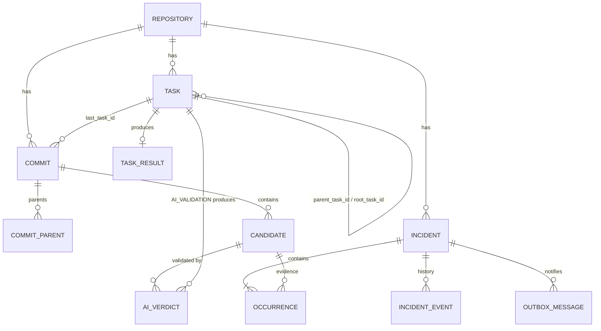
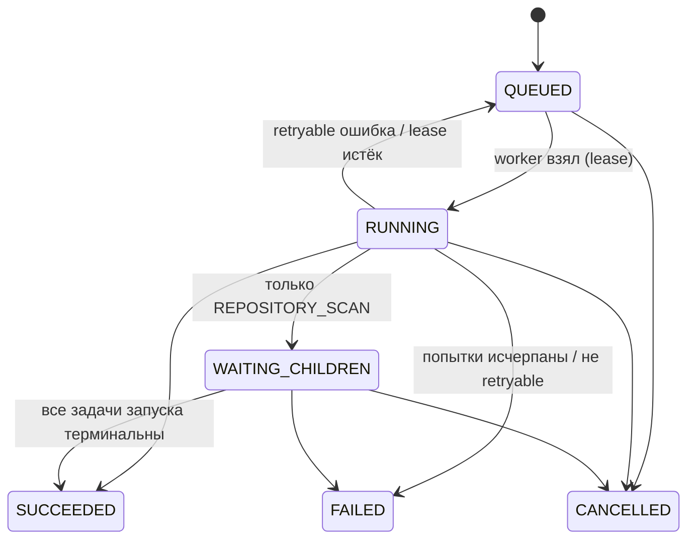
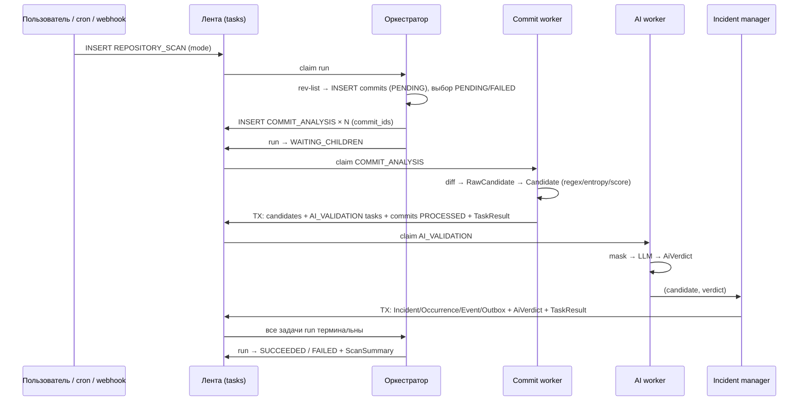

# Модели данных sentinel_key

Исходники моделей: `sentinel_key/src/models/` — **один файл на одну модель** (класс), сгруппированы по подпакетам `repository` / `task` / `candidate` / `incident` (+ `common`). Этот документ — источник истины: код моделей пишется по нему, изменения моделей начинаются с правки документа.

> **Статус реализации.** Модели `AiVerdict`, `AiValidationPayload`, `AiValidationOutput` описаны здесь полностью, но в коде их добавляет трек `ai_validation`. Значение `TaskKind.AI_VALIDATION = 3` уже зарезервировано.

## 1. Соглашения

| Тема | Правило |
|---|---|
| **Первичный ключ** | Везде `id: int` → SQLite `INTEGER PRIMARY KEY` (алиас rowid, 64 бит, монотонный, компактный индекс). Строковые PK **не используются**. Исключение — связующие таблицы и 1:1 таблицы с составным/наследуемым PK из `int`-колонок (указано явно). |
| **Внешние ключи** | Всегда `int`, ссылаются на `id`. |
| **Естественные ключи** | SHA коммита, fingerprint секрета, idempotency-ключ — это `bytes` (BLOB) с `UNIQUE`-индексом, **не PK**. SHA-1 = 20 байт, SHA-256 (object-format sha256) = 32 байта; в коде и логах отображается как hex. |
| **Новые объекты** | До первого `INSERT` `id = None` (тип `int \| None`); БД присваивает id. Дедупликация — через `UNIQUE`-индексы и `INSERT … ON CONFLICT`, а не через вычисляемый строковый id. |
| **Enum** | `IntEnum`/`IntFlag`, в БД `SMALLINT`. Числовые значения закреплены в документе и не меняются. Enum, используемый одной моделью, описан рядом с ней; общие — в §2. |
| **Время** | В коде `datetime` (UTC, tz-aware); в БД `INTEGER` — unix epoch, миллисекунды. |
| **bool** | В БД `INTEGER` 0/1. |
| **Структурные данные** | `JSON` (TEXT) только для того, по чему не ищут: payload, output, metrics, список сработавших правил. Всё, по чему фильтруют/джойнят, — отдельные колонки. |
| **Секреты** | Сырое значение секрета **не является полем ни одной сохраняемой модели**. Допустимо только в `RawCandidate` (память процесса). |
| **Value object** | Встроенный объект без собственной таблицы (`ScoreBreakdown`, `TaskError`, payload/output-классы): его поля либо «разворачиваются» в колонки владельца, либо сериализуются в JSON — указано в описании. |

Обозначения в таблицах: **PK** — первичный ключ, **FK** — внешний, **UQ** — уникальность, `?` / `None` — допускается NULL.

## 2. Общие перечисления

Используются несколькими моделями.

### `SecretType(IntEnum)`

Тип секрета. Используется в `RawCandidate`, `Candidate`, `AiVerdict`, `Incident`, `IncidentPolicy`.

| Имя | Значение |
|---|---|
| `UNKNOWN` | 0 |
| `AWS_ACCESS_KEY` | 1 |
| `AWS_SECRET_KEY` | 2 |
| `GITHUB_TOKEN` | 3 |
| `SLACK_TOKEN` | 4 |
| `JWT` | 5 |
| `PRIVATE_KEY` | 6 |
| `BEARER_TOKEN` | 7 |
| `DATABASE_URL` | 8 |
| `DATABASE_PASSWORD` | 9 |
| `API_KEY` | 10 |
| `GENERIC_PASSWORD` | 11 |
| `OTHER` | 99 |

### `Severity(IntEnum)`

Критичность. Порядок значений значим (сравнения `>`/`<`, повышение на уровень).

| Имя | Значение |
|---|---|
| `LOW` | 1 |
| `MEDIUM` | 2 |
| `HIGH` | 3 |
| `CRITICAL` | 4 |

### `DetectorFlags(IntFlag)`

Какие детекторы сработали. Битовая маска хранится одной колонкой `SMALLINT`; в UI отображается как `regex+entropy+llm`.

| Имя | Значение |
|---|---|
| `REGEX` | 1 |
| `ENTROPY` | 2 |
| `CONTEXT` | 4 |
| `LLM` | 8 |

---

## 3. Модели

Сводка таблиц и связей:

### 3.1. `Repository`

Таблица `repositories`. Отслеживаемый репозиторий.

| Поле | Python-тип | Тип в БД | Ключ | Описание |
|---|---|---|---|---|
| `id` | `int \| None` | INTEGER | **PK** | |
| `location` | `str` | TEXT | UQ | URL или локальный путь к репозиторию |
| `name` | `str` | TEXT | | отображаемое имя |
| `default_ref` | `str \| None` | TEXT | | ветка/ref по умолчанию (для проверки HEAD) |
| `created_at` | `datetime` | INTEGER | | |
| `last_scan_at` | `datetime \| None` | INTEGER | | завершение последнего успешного запуска |
| `last_scan_task_id` | `int \| None` | INTEGER | FK → `tasks.id` | корневая задача последнего запуска |
| `version` | `int` | INTEGER | | версия записи (optimistic lock), старт 1 |

---

### 3.2. `Commit`

Таблица `commits`. **Состояние обработки по SHA** (вместо `last_processed_commit` и `state.json`): множество «обработанных SHA» репозитория = строки со `status = PROCESSED`.

| Поле | Python-тип | Тип в БД | Ключ | Описание |
|---|---|---|---|---|
| `id` | `int \| None` | INTEGER | **PK** | порядок вставки внутри запуска = топологический порядок от старых к новым |
| `repository_id` | `int` | INTEGER | FK → `repositories.id` | |
| `sha` | `bytes` | BLOB(20\|32) | UQ вместе с `repository_id` | SHA коммита в бинарном виде |
| `status` | `CommitStatus` | SMALLINT | | см. ниже |
| `is_merge` | `bool` | INTEGER | | более одного родителя |
| `committed_at` | `datetime \| None` | INTEGER | | время коммита из Git (только для аудита; в логике состояния не участвует) |
| `last_task_id` | `int \| None` | INTEGER | FK → `tasks.id` | последняя `COMMIT_ANALYSIS`-задача, бравшая коммит |
| `scan_run_id` | `int \| None` | INTEGER | FK → `tasks.id` | корневая задача запуска, обработавшего коммит |
| `processed_at` | `datetime \| None` | INTEGER | | когда стал `PROCESSED` |
| `error_code` | `ErrorCode \| None` | SMALLINT | | причина, если `FAILED` |

Индексы: `UNIQUE(repository_id, sha)`, `(repository_id, status, id)`.

**`CommitStatus(IntEnum)`:** `PENDING = 1` (обнаружен планировщиком, ещё не обработан), `PROCESSED = 2`, `FAILED = 3` (ошибка Git/diff; повторяется следующим запуском).

Правило планировщика: «новые» коммиты запуска = только что вставленные + существующие со статусом `PENDING`/`FAILED`.

---

### 3.3. `CommitParent`

Таблица `commit_parents`. Родители коммита (Git — граф: merge, ветки).

| Поле | Python-тип | Тип в БД | Ключ | Описание |
|---|---|---|---|---|
| `commit_id` | `int` | INTEGER | **PK** (часть) FK → `commits.id` | |
| `position` | `int` | SMALLINT | **PK** (часть) | порядок родителя; `0` = first parent |
| `parent_sha` | `bytes` | BLOB(20\|32) | | SHA родителя (может отсутствовать в `commits`, напр. shallow-история) |

---

### 3.4. `Task` — задача

Таблица `tasks`. Единица работы в ленте. Запуск анализа = корневая задача `REPOSITORY_SCAN`.

| Поле | Python-тип | Тип в БД | Ключ | Описание |
|---|---|---|---|---|
| `id` | `int \| None` | INTEGER | **PK** | |
| `kind` | `TaskKind` | SMALLINT | | вид задачи |
| `repository_id` | `int` | INTEGER | FK → `repositories.id` | |
| `status` | `TaskStatus` | SMALLINT | | текущий статус |
| `payload` | `ScanTaskPayload \| CommitAnalysisPayload \| AiValidationPayload` | TEXT (JSON) | | параметры; класс определяется `kind` |
| `idempotency_key` | `bytes` | BLOB(16) | UQ | защита от дублей (см. ниже) |
| `root_task_id` | `int \| None` | INTEGER | FK → `tasks.id` | `NULL` у корня (`REPOSITORY_SCAN`); у остальных — id корня запуска. Свойство `run_id = root_task_id or id` |
| `parent_task_id` | `int \| None` | INTEGER | FK → `tasks.id` | кто породил |
| `priority` | `int` | SMALLINT | | меньше — раньше. По умолчанию: scan 10, ai 50, commit 100 |
| `attempts` | `int` | SMALLINT | | число запусков (растёт при переходе в `RUNNING`) |
| `max_attempts` | `int` | SMALLINT | | по умолчанию 3; для `AI_VALIDATION` — 5 |
| `not_before` | `datetime \| None` | INTEGER | | не выдавать раньше (backoff, отложенный старт) |
| `lease_owner` | `str \| None` | TEXT | | идентификатор worker'а, взявшего задачу |
| `lease_expires_at` | `datetime \| None` | INTEGER | | когда аренда истечёт |
| `error_code` | `ErrorCode \| None` | SMALLINT | | последняя ошибка (поля `TaskError`) |
| `error_message` | `str \| None` | TEXT | | без секретов |
| `error_retryable` | `bool \| None` | INTEGER | | |
| `created_at` | `datetime` | INTEGER | | |
| `started_at` | `datetime \| None` | INTEGER | | первый запуск |
| `finished_at` | `datetime \| None` | INTEGER | | |

Индексы:
- частичный `(priority, not_before, id) WHERE status = QUEUED` — выбор следующей задачи;
- `(root_task_id)`, `(parent_task_id)`;
- частичный `UNIQUE(repository_id) WHERE kind = REPOSITORY_SCAN AND status IN (QUEUED, RUNNING, WAITING_CHILDREN)` — один активный запуск на репозиторий;
- `(lease_expires_at) WHERE status = RUNNING` — поиск протухших аренд.

**`TaskKind(IntEnum)`:** `REPOSITORY_SCAN = 1`, `COMMIT_ANALYSIS = 2`, `AI_VALIDATION = 3`.

**`TaskStatus(IntEnum)`:** `QUEUED = 1`, `RUNNING = 2`, `WAITING_CHILDREN = 3` (только `REPOSITORY_SCAN`), `SUCCEEDED = 4`, `FAILED = 5`, `CANCELLED = 6`. Терминальные: 4, 5, 6.

**Автомат статусов**

**Методы модели**
- `transition(new_status, now)` — проверяет допустимость перехода, иначе `InvalidTransition`. В `RUNNING`: `attempts += 1`, `started_at` при первом запуске. В терминальный: `finished_at`. Вне `RUNNING` сбрасывает `lease_*`.
- `schedule_retry(error)` — если `error.retryable` и `attempts < max_attempts`: `RUNNING → QUEUED`, `not_before = now + base · 2^(attempts − 1)` (1→2→4→8 с); иначе `FAILED`.
- `is_terminal`, `run_id`.

**Ключи идемпотентности** (`idempotency_key = sha256(...)[:16]`):

| `kind` | Состав ключа |
|---|---|
| `REPOSITORY_SCAN` | `kind, repository_id, случайный nonce запуска` (дубли ограничивает частичный UQ «один активный запуск») |
| `COMMIT_ANALYSIS` | `kind, repository_id, root_task_id запуска, отсортированные commit_id пачки` (для самостоятельной задачи `root_task_id = NULL`) |
| `AI_VALIDATION` | `kind, candidate_id, prompt_version` |

#### 3.4.1. `TaskError` (value object)

Встраивается в `Task` (колонки `error_*`) и `TaskResult`.

| Поле | Python-тип | Описание |
|---|---|---|
| `code` | `ErrorCode` | |
| `message` | `str` | человекочитаемо, **без секретов** |
| `retryable` | `bool` | можно ли повторить |

**`ErrorCode(IntEnum)`:** `GIT_ERROR = 1`, `DIFF_ERROR = 2`, `LLM_FAILED = 3`, `LLM_INVALID_RESPONSE = 4`, `MASKING_VIOLATION = 5`, `TIMEOUT = 6`, `LEASE_EXPIRED = 7`, `INTERNAL = 99`.

#### 3.4.2. `ScanTaskPayload` (value object, JSON; для `REPOSITORY_SCAN`)

| Поле | Python-тип | По умолчанию | Описание |
|---|---|---|---|
| `mode` | `ScanMode` | `INCREMENTAL` | |
| `trigger` | `Trigger` | `MANUAL` | |
| `batch_size` | `int` | `50` | коммитов в одной `COMMIT_ANALYSIS` |
| `refs` | `list[str]` | `["--all"]` | что передать в `git rev-list` |
| `target_shas` | `list[str]` | `[]` | только для `TARGETED` (hex) |
| `ai_enabled` | `bool` | `true` | разрешены ли `AI_VALIDATION`-задачи в этом запуске |
| `planned_commits_total` | `int \| None` | `None` | число SHA, достижимых по refs на момент планирования; выставляет orchestrator |
| `planned_commits_new` | `int \| None` | `None` | число коммитов, включённых в дочерние задачи; выставляет orchestrator |

**`ScanMode(IntEnum):`** `FULL = 1` (нет состояния — вся история; выбирается автоматически при первом запуске), `INCREMENTAL = 2` (коммиты `PENDING`/`FAILED` + новые), `TARGETED = 3` (явный список, переанализ).
**`Trigger(IntEnum):`** `MANUAL = 1`, `SCHEDULE = 2`, `WEBHOOK = 3`.

#### 3.4.3. `CommitAnalysisPayload` (value object, JSON; для `COMMIT_ANALYSIS`)

| Поле | Python-тип | Описание |
|---|---|---|
| `commit_ids` | `list[int]` | `commits.id` пачки в топологическом порядке |

#### 3.4.4. `AiValidationPayload` (value object, JSON; для `AI_VALIDATION`)

| Поле | Python-тип | Описание |
|---|---|---|
| `candidate_id` | `int` | `candidates.id` |
| `prompt_version` | `int` | версия prompt'а (входит в идемпотентность) |
| `model` | `str \| None` | переопределение модели; `None` = из конфига |

---

### 3.5. `TaskResult` — результат

Таблица `task_results`. Не более одного на задачу (1:0..1).

| Поле | Python-тип | Тип в БД | Ключ | Описание |
|---|---|---|---|---|
| `task_id` | `int` | INTEGER | **PK**, FK → `tasks.id` | |
| `outcome` | `Outcome` | SMALLINT | | исход |
| `output` | `ScanSummary \| CommitAnalysisOutput \| AiValidationOutput \| None` | TEXT (JSON) | | класс определяется `Task.kind` |
| `error_code` | `ErrorCode \| None` | SMALLINT | | поля `TaskError` |
| `error_message` | `str \| None` | TEXT | | |
| `error_retryable` | `bool \| None` | INTEGER | | |
| `metrics` | `dict[str, float]` | TEXT (JSON) | | `duration_s`, `lines_per_s`, `llm_tokens_in`, `llm_tokens_out`… |
| `created_at` | `datetime` | INTEGER | | |

**`Outcome(IntEnum)`:** `OK = 1`, `PARTIAL = 2` (часть коммитов/кандидатов не обработана, остальное готово), `FAILED = 3`.

#### 3.5.1. `ScanSummary` (output `REPOSITORY_SCAN`)

| Поле | Python-тип | Описание |
|---|---|---|
| `mode` | `ScanMode` | фактический режим |
| `commits_total` | `int` | всего коммитов в истории (по refs) |
| `commits_new` | `int` | взято в этот запуск |
| `commits_done` | `int` | стали `PROCESSED` |
| `commits_failed` | `int` | стали `FAILED` |
| `candidates` | `int` | сохранено кандидатов (`SUSPICIOUS` + `AI_VALIDATION`) |
| `ai_tasks` | `int` | создано `AI_VALIDATION` |
| `ai_failed` | `int` | из них `FAILED` |
| `incidents_opened` | `int` | |
| `incidents_updated` | `int` | добавлен `Occurrence` / повышена severity / reopen |

#### 3.5.2. `CommitAnalysisOutput` (output `COMMIT_ANALYSIS`)

| Поле | Python-тип | Описание |
|---|---|---|
| `commit_ids_done` | `list[int]` | |
| `commit_ids_failed` | `list[int]` | |
| `lines_analyzed` | `int` | добавленные строки, прошедшие анализ |
| `candidates_total` | `int` | сохранено кандидатов после фильтра по route |
| `suspicious` | `int` | сохранено как `SUSPICIOUS` |
| `ai_task_ids` | `list[int]` | созданные `AI_VALIDATION` |
| `incident_ids` | `list[int]` | инциденты, созданные или обновлённые локально (без LLM) |

#### 3.5.3. `AiValidationOutput` (output `AI_VALIDATION`)

| Поле | Python-тип | Описание |
|---|---|---|
| `verdict_id` | `int` | `ai_verdicts.id` |
| `incident_id` | `int \| None` | созданный или обновлённый инцидент; `None` — инцидент не открыт |

---

### 3.6. `RawCandidate` (только память, не персистится)

Выход предобработки, вход статического анализатора. **Единственный** класс, где допустимо сырое значение. Все чувствительные поля — `repr=False`, класс запрещает `pickle`/`json`-сериализацию (`__reduce__` бросает исключение).

| Поле | Python-тип | Описание |
|---|---|---|
| `repository_id` | `int` | |
| `commit_id` | `int` | |
| `file_path` | `str` | |
| `line_number` | `int` | номер строки в новой версии файла |
| `key_name` | `str \| None` | имя переменной/заголовка (`DATABASE_PASSWORD`, `Authorization`) |
| `raw_value` | `str` (`repr=False`) | сырое значение |
| `source_line_raw` | `str` (`repr=False`) | исходная строка |
| `context_raw` | `list[str]` (`repr=False`) | ±N окружающих строк |
| `source_line_masked` | `str` | исходная строка с заменой значения на `value_masked` |
| `context_masked` | `str` | контекст, собранный через `\n`, с той же заменой |
| `secret_type_hint` | `SecretType` | подсказка по структуре (`BEARER_TOKEN`, `DATABASE_URL`, иначе `UNKNOWN`) |
| `value_fingerprint` | `bytes` | HMAC-SHA256 (32 байта), считается предобработкой сразу |
| `value_masked` | `str` | `AKIA...MPLE` |

Метод `to_candidate(score, flags, route, ...) -> Candidate` строит сохраняемую модель и
переносит в неё только маскированные строку и контекст; сырые поля в неё
не попадают.

---

### 3.7. `Candidate` — кандидат

Таблица `candidates`. Потенциальный секрет, прошедший локальный анализ и сохранённый (`SUSPICIOUS` или `AI_VALIDATION`; `IGNORE` не сохраняется).

| Поле | Python-тип | Тип в БД | Ключ | Описание |
|---|---|---|---|---|
| `id` | `int \| None` | INTEGER | **PK** | |
| `repository_id` | `int` | INTEGER | FK → `repositories.id` | денормализация для выборок |
| `commit_id` | `int` | INTEGER | FK → `commits.id` | |
| `file_path` | `str` | TEXT | | путь в репозитории |
| `line_number` | `int` | INTEGER | | |
| `key_name` | `str \| None` | TEXT | | |
| `secret_type` | `SecretType` | SMALLINT | | определён regex/структурой |
| `value_masked` | `str` | TEXT | | |
| `value_fingerprint` | `bytes` | BLOB(32) | | HMAC-SHA256 значения |
| `entropy` | `float` | REAL | | энтропия Шеннона значения |
| `regex_rules` | `list[str]` | TEXT (JSON) | | имена сработавших правил |
| `detector_flags` | `DetectorFlags` | SMALLINT | | |
| `source_line_masked` | `str` | TEXT | | |
| `context_masked` | `str` | TEXT | | |
| `is_test_context` | `bool` | INTEGER | | тесты/фикстуры/примеры |
| `score_regex` | `float` | REAL | | компоненты `ScoreBreakdown` |
| `score_entropy` | `float` | REAL | | |
| `score_context` | `float` | REAL | | |
| `score_token_type` | `float` | REAL | | |
| `score_total` | `float` | REAL | | `min(1.0, сумма компонентов)` |
| `route` | `Route` | SMALLINT | | |
| `created_at` | `datetime` | INTEGER | | |

Индексы: `UNIQUE(commit_id, file_path, line_number, value_fingerprint)` — идемпотентность (повторный анализ коммита делает upsert, а не дубль); `(repository_id, value_fingerprint)` — поиск того же секрета в других коммитах; `(route)`.

**`Route(IntEnum)`:** `IGNORE = 0`, `SUSPICIOUS = 1`, `AI_VALIDATION = 2`. Пороги: `score_total ≥ high` → `AI_VALIDATION`; `≥ low` → `SUSPICIOUS`; иначе `IGNORE` (значения в `ScoringConfig`).

#### 3.7.1. `ScoreBreakdown` (value object, колонки `score_*`)

| Поле | Python-тип | Описание |
|---|---|---|
| `regex` | `float` | вклад regex |
| `entropy` | `float` | вклад энтропии |
| `context` | `float` | вклад контекста |
| `token_type` | `float` | вклад типа токена |
| `total` (свойство) | `float` | `min(1.0, regex + entropy + context + token_type)` |

---

### 3.8. `AiVerdict` — вердикт ИИ

Таблица `ai_verdicts`. Результат одной `AI_VALIDATION`-задачи; сохраняется отдельно, чтобы вердикт можно было аудировать и переиспользовать.

| Поле | Python-тип | Тип в БД | Ключ | Описание |
|---|---|---|---|---|
| `id` | `int \| None` | INTEGER | **PK** | |
| `task_id` | `int` | INTEGER | FK → `tasks.id`, UQ | порождающая `AI_VALIDATION`-задача |
| `candidate_id` | `int` | INTEGER | FK → `candidates.id` | |
| `is_secret` | `bool` | INTEGER | | |
| `secret_type` | `SecretType` | SMALLINT | | |
| `confidence` | `float` | REAL | | 0.0–1.0 |
| `severity` | `Severity` | SMALLINT | | |
| `reason` | `str` | TEXT | | |
| `recommendation` | `str` | TEXT | | |
| `model` | `str` | TEXT | | идентификатор модели |
| `prompt_version` | `int` | INTEGER | | |
| `created_at` | `datetime` | INTEGER | | |

Индекс: `(candidate_id)`. Валидация при создании: `0 ≤ confidence ≤ 1`, `severity` и `secret_type` из enum, строки не пустые. Невалидный ответ LLM **не превращается** в `AiVerdict` — это `ErrorCode.LLM_INVALID_RESPONSE`.

---

### 3.9. `Incident` — инцидент

Таблица `incidents`. Подтверждённая или высоковероятная утечка credentials, требующая реакции человека. Один секрет в репозитории = один инцидент, независимо от числа коммитов/файлов.

| Поле | Python-тип | Тип в БД | Ключ | Описание |
|---|---|---|---|---|
| `id` | `int \| None` | INTEGER | **PK** | |
| `repository_id` | `int` | INTEGER | FK → `repositories.id` | |
| `fingerprint` | `bytes` | BLOB(32) | UQ вместе с `repository_id` | HMAC-SHA256 значения — ключ дедупликации |
| `secret_type` | `SecretType` | SMALLINT | | |
| `severity` | `Severity` | SMALLINT | | |
| `confidence` | `float` | REAL | | максимум из подтверждений |
| `detector_flags` | `DetectorFlags` | SMALLINT | | флаги кандидата, `\| LLM` если был вердикт |
| `evidence_masked` | `str` | TEXT | | `AKIA...MPLE` |
| `reason` | `str` | TEXT | | из вердикта или причина локального правила |
| `recommendation` | `str` | TEXT | | |
| `status` | `IncidentStatus` | SMALLINT | | |
| `still_in_head` | `bool \| None` | INTEGER | | `True` — секрет в текущем HEAD; `False` — только в истории; `None` — не проверялось |
| `assignee` | `str \| None` | TEXT | | ответственный |
| `first_commit_id` | `int` | INTEGER | FK → `commits.id` | коммит первого обнаружения |
| `last_verdict_id` | `int \| None` | INTEGER | FK → `ai_verdicts.id` | |
| `created_at` | `datetime` | INTEGER | | |
| `updated_at` | `datetime` | INTEGER | | |
| `resolved_at` | `datetime \| None` | INTEGER | | для `REMEDIATED`/`FALSE_POSITIVE` |
| `version` | `int` | INTEGER | | optimistic lock |

Индексы: `UNIQUE(repository_id, fingerprint)`, `(repository_id, status, severity)`.

**`IncidentStatus(IntEnum)`:** `OPEN = 1`, `ACKNOWLEDGED = 2`, `REMEDIATED = 3` (секрет отозван/ротирован), `FALSE_POSITIVE = 4`, `ACCEPTED_RISK = 5`.

Переходы: `OPEN → ACKNOWLEDGED | REMEDIATED | FALSE_POSITIVE | ACCEPTED_RISK`; `ACKNOWLEDGED → REMEDIATED | FALSE_POSITIVE | ACCEPTED_RISK`; из `REMEDIATED`/`FALSE_POSITIVE`/`ACCEPTED_RISK` → только `OPEN` (**reopen** при повторном обнаружении того же fingerprint).

**Методы модели:** `set_status(new, actor, note)` (проверка перехода, `resolved_at`, событие), `raise_severity(new)` (только вверх), `add_occurrence(candidate, ai_task_id)`.

#### Когда открывается инцидент

Решает `IncidentManager.decide(candidate, verdict, policy)` (см. `modules.md`), правила:

1. **Есть `AiVerdict` → он финальный.** `is_secret = true` и `confidence ≥ policy.min_ai_confidence` → инцидент. Иначе — нет (вердикт может быть «вето» даже при сильном regex).
2. **Нет вердикта** (LLM выключена/недоступна) → инцидент только если одновременно: `secret_type ∈ policy.trusted_formats`, `score_total ≥ policy.min_local_score`, `is_test_context = false`.
3. Иначе кандидат остаётся `SUSPICIOUS`/`AI_VALIDATION` без инцидента.

**Severity:** базовая — из вердикта (локальный путь — `HIGH`); при `still_in_head = true` и `policy.bump_if_in_head` повышается на один уровень (не выше `CRITICAL`) и не понижается.

**Дедупликация:** тот же `fingerprint` в другом коммите/файле → новый `Occurrence` в существующем инциденте. Закрытый инцидент при повторном обнаружении → `OPEN` + событие `REOPENED`.

---

### 3.10. `Occurrence` — место обнаружения

Таблица `occurrences`. Связь инцидента с кандидатами (коммит, файл, строка берутся из `Candidate`).

| Поле | Python-тип | Тип в БД | Ключ | Описание |
|---|---|---|---|---|
| `incident_id` | `int` | INTEGER | **PK** (часть), FK → `incidents.id` | |
| `candidate_id` | `int` | INTEGER | **PK** (часть), FK → `candidates.id` | |
| `ai_task_id` | `int \| None` | INTEGER | FK → `tasks.id` | задача, подтвердившая находку (`None` для локального пути) |
| `seen_at` | `datetime` | INTEGER | | |

---

### 3.11. `IncidentEvent` — журнал инцидента

Таблица `incident_events`. Append-only.

| Поле | Python-тип | Тип в БД | Ключ | Описание |
|---|---|---|---|---|
| `id` | `int \| None` | INTEGER | **PK** | |
| `incident_id` | `int` | INTEGER | FK → `incidents.id` | |
| `kind` | `IncidentEventKind` | SMALLINT | | |
| `note` | `str \| None` | TEXT | | без секретов |
| `actor` | `str \| None` | TEXT | | пользователь или `system` |
| `created_at` | `datetime` | INTEGER | | |

Индекс: `(incident_id, id)`.

**`IncidentEventKind(IntEnum)`:** `OPENED = 1`, `OCCURRENCE_ADDED = 2`, `SEVERITY_RAISED = 3`, `STATUS_CHANGED = 4`, `REOPENED = 5`, `NOTIFIED = 6`.

---

### 3.12. `OutboxMessage` — уведомления (outbox)

Таблица `outbox_messages`. Создаётся в одной транзакции с инцидентом; отдельный процесс доставляет сообщение — не теряем и не дублируем уведомления.

| Поле | Python-тип | Тип в БД | Ключ | Описание |
|---|---|---|---|---|
| `id` | `int \| None` | INTEGER | **PK** | |
| `incident_id` | `int` | INTEGER | FK → `incidents.id` | |
| `channel` | `NotifyChannel` | SMALLINT | | |
| `payload` | `dict[str, Any]` | TEXT (JSON) | | только маскированные данные |
| `status` | `OutboxStatus` | SMALLINT | | |
| `attempts` | `int` | SMALLINT | | |
| `not_before` | `datetime \| None` | INTEGER | | |
| `created_at` | `datetime` | INTEGER | | |
| `sent_at` | `datetime \| None` | INTEGER | | |

**`NotifyChannel(IntEnum)`:** `WEBHOOK = 1`, `SLACK = 2`, `EMAIL = 3`. **`OutboxStatus(IntEnum)`:** `PENDING = 1`, `SENT = 2`, `FAILED = 3`.

---

## 4. Конфигурационные модели (не персистятся)

Загружаются из конфигурации, неизменяемы (`frozen`).

### 4.1. `PreprocessorConfig`

| Поле | Python-тип | По умолчанию | Описание |
|---|---|---|---|
| `context_lines` | `int` | `2` | число строк контекста до и после добавленной строки |
| `max_line_len` | `int` | `4096` | строки большей длины не анализируются |
| `min_bare_token_len` | `int` | `20` | минимальная длина «голого» токена |
| `mask_visible_chars` | `int` | `4` | число видимых символов с каждого края длинного значения |
| `ignored_path_parts` | `frozenset[str]` | `{vendor, node_modules, dist, build, .git}` | каталоги, содержимое которых не анализируется |
| `ignored_file_names` | `frozenset[str]` | `{package-lock.json, yarn.lock, pnpm-lock.yaml, poetry.lock, Pipfile.lock, Cargo.lock}` | lock-файлы, которые не анализируются |
| `ignored_suffixes` | `tuple[str, ...]` | `(.lock, .min.js, .min.css)` | суффиксы lock- и minified-файлов |

### 4.2. `ScoringConfig`

| Поле | Python-тип | По умолчанию | Описание |
|---|---|---|---|
| `weight_regex` | `float` | `0.5` | вклад совпадения regex |
| `regex_rule_weights` | `tuple[tuple[str, float], ...]` | каталог правил: `1.0` для надёжных форматов, `0.9` для JWT/AWS secret, `0.8` для пароля URL, `0.6` для Bearer, `0.5` для generic | относительная сила каждого regex-правила; имена уникальны |
| `weight_entropy` | `float` | `0.2` | вклад высокой энтропии |
| `weight_context` | `float` | `0.2` | вклад подозрительного имени переменной/пути |
| `weight_token_type` | `float` | `0.1` | вклад типа токена |
| `low_threshold` | `float` | `0.3` | ниже — `IGNORE` |
| `high_threshold` | `float` | `0.7` | от — `AI_VALIDATION` |
| `min_entropy_length` | `int` | `16` | минимальная длина для энтропийного признака |
| `entropy_hex_threshold` | `float` | `3.5` | порог для hex-значений |
| `entropy_base64_threshold` | `float` | `4.5` | порог для base64-подобных значений |
| `entropy_other_threshold` | `float` | `3.5` | порог для остальных значений |
| `max_analyzed_length` | `int` | `4096` | ограничение входа regex и расчёта энтропии |
| `test_context_factor` | `float` | `0.25` | множитель балла в тестах, фикстурах и примерах |
| `false_positive_factor` | `float` | `0.1` | множитель балла для UUID, hash, timestamp, placeholder и публичных значений |

### 4.3. `IncidentPolicy`

| Поле | Python-тип | По умолчанию | Описание |
|---|---|---|---|
| `min_ai_confidence` | `float` | `0.85` | минимальная уверенность вердикта ИИ |
| `trusted_formats` | `frozenset[SecretType]` | `{PRIVATE_KEY, AWS_ACCESS_KEY, GITHUB_TOKEN, SLACK_TOKEN}` | форматы, достаточно надёжные без ИИ |
| `min_local_score` | `float` | `0.9` | минимальный `score_total` для локального пути |
| `bump_if_in_head` | `bool` | `true` | повышать severity, если секрет в HEAD |

Значения по умолчанию — стартовые, подлежат калибровке на реальных данных.

---

## 5. Моделирование запуска анализа

Запуск — корневая `Task(kind=REPOSITORY_SCAN)`. Всё, что происходит в его рамках, связано через `root_task_id`.

- **Режимы.** `FULL` — выбирается автоматически, если в `commits` для репозитория нет `PROCESSED`; `INCREMENTAL` — всё, что не `PROCESSED`; `TARGETED` — явный список.
- **Завершение.** Корень остаётся в `WAITING_CHILDREN`, пока есть нетерминальные задачи с его `root_task_id`, включая `AI_VALIDATION`. Итог: все `SUCCEEDED` → `Outcome.OK`; часть `FAILED` при готовом остальном → `PARTIAL`; не удалось получить историю → `FAILED`.
- **Когда коммит `PROCESSED`.** После локального анализа и постановки AI-задач — в одной транзакции. Судьба AI-задач на статус коммита не влияет: они долговечны и ретраятся сами.
- **Идемпотентность.** Повторная постановка той же пачки отсекается `Task.idempotency_key`; повторный анализ коммита — `UNIQUE` на `candidates`; один и тот же секрет — `UNIQUE(repository_id, fingerprint)` на `incidents`.

## 6. Сводка уникальных ограничений

| Таблица | Ограничение |
|---|---|
| `repositories` | `UNIQUE(location)` |
| `commits` | `UNIQUE(repository_id, sha)` |
| `commit_parents` | `PK(commit_id, position)` |
| `tasks` | `UNIQUE(idempotency_key)`; частичный `UNIQUE(repository_id)` для активного `REPOSITORY_SCAN` |
| `task_results` | `PK(task_id)` |
| `candidates` | `UNIQUE(commit_id, file_path, line_number, value_fingerprint)` |
| `ai_verdicts` | `UNIQUE(task_id)` |
| `incidents` | `UNIQUE(repository_id, fingerprint)` |
| `occurrences` | `PK(incident_id, candidate_id)` |
